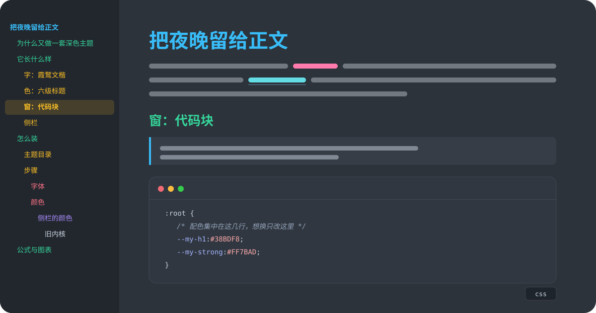

# my-theme

一套给 [Typora](https://typora.io) 的夜间主题：霞鹜文楷正文，六级标题各一种颜色，代码块收进一扇小窗。基于官方 night 二次开发。



<!-- 在 Typora 里打开 示例文章.md，截一张编辑器截图存为 assets/preview.png，再去掉下一行的注释 -->
<!--  -->

## 特点

- **文楷正文**：正文、标题、代码共用霞鹜文楷，Light / Regular / Medium 三档字重随主题附带，不依赖系统安装。强调和代码注释保持倾斜，粗体用真实字重，不假粗。
- **六色标题**：一级到六级分别是天蓝、薄荷绿、琥珀、暖粉、淡紫、浅灰，字号逐级收窄。侧栏大纲和 `[TOC]` 用同一组颜色。
- **代码小窗**：三枚圆点、一道分隔线、语言标签落在窗外不压边框；选中只有一层底色，当前行高亮保留；源码模式同一套配色。
- **块级元素**：引用左线、五种 GitHub 风格提示块（NOTE / TIP / IMPORTANT / WARNING / CAUTION）、隔行表格、自绘任务勾、脚注、折叠块、术语表、公式、Mermaid。
- **侧栏**：和正文同一种字体；大纲与文件树是同一种圆角高亮，当前项用所在标题自己的颜色洗成底色。
- **导出一致**：HTML / PDF 与编辑器同字体同配色，代码窗的装饰保留，打印样式单独处理。
- **跟随字号**：主题用 rem，Typora 偏好设置里的字号调整整篇生效，侧栏不受影响。

## 安装

`my-theme.css` 用相对路径引用旁边的 `my-theme/`（分段样式和字体都在里面）。两样一起复制，名字不要改。

| 系统 | 主题目录 |
| --- | --- |
| macOS | `~/Library/Application Support/abnerworks.Typora/themes/` |
| Windows | `%APPDATA%\Typora\themes\` |
| Linux | `~/.config/Typora/themes/` |

1. 把 `my-theme.css` 和整个 `my-theme/` 放进上表目录
2. 重新打开 Typora
3. 菜单 **主题** 里选择 **my-theme**

macOS 可以直接执行：

```bash
cp my-theme.css "$HOME/Library/Application Support/abnerworks.Typora/themes/"
cp -R my-theme "$HOME/Library/Application Support/abnerworks.Typora/themes/"
```

`demo/` 是官方 night 的原始文件，只供对照，不要复制进主题目录。

## 需要开启的 Typora 选项

高亮、上标、下标、行内公式、图表在 Typora 里默认关闭。偏好设置 → Markdown → 语法支持 里勾选，示例文章里对应的写法才会渲染。

## 示例文章

[示例文章.md](示例文章.md) 是用这套主题排的一篇介绍稿，常用的 Markdown 都放在有内容的位置上：目录、六级标题、强调、列表、任务、嵌套引用、五种提示块、对齐表格、图片、CSS / JavaScript / Python / Bash / diff 代码块、公式、流程图和时序图、术语表、折叠块、脚注。在 Typora 里打开并选中 my-theme，滚一遍就能看到全部效果。GitHub 页面只显示源码排版。

## 自定义

配色和字体集中在 `my-theme.css` 的设计变量里（搜索 `--my-`）：

```css
:root {
  --my-font: "LXGW WenKai", "PingFang SC", "PingFang TC", "Microsoft YaHei", sans-serif;
  --my-text: #E2E8F0;     /* 正文 */
  --my-h1: #38BDF8;       /* 一级标题，也是列表圆点、任务勾、引用左线 */
  --my-h2: #34D399;
  --my-h3: #FBBF24;
  --my-h4: #FB7185;
  --my-h5: #A78BFA;
  --my-h6: #CBD5E1;
  --my-strong: #FF7BAD;   /* 加粗 */
  --my-link: #63DCE4;     /* 链接 */
  --my-code-bg: #303741;  /* 代码窗 */
}
```

- **换字体**：改 `--my-font`。要随主题分发，把 woff2 放进 `my-theme/fonts/`，再改文件顶部的 `@font-face`。
- **换标题色**：改 `--my-h1` 到 `--my-h6`，正文标题、侧栏大纲、目录会一起变。提示块和代码高亮的颜色写在各自的规则里，需要单独改。
- **换背景**：文件顶部 `:root` 里的 `--bg-color`（编辑区）和 `--side-bar-bg-color`（侧栏）。

## 目录结构

```
my-theme.css                主题入口：night 基底 + my-theme 层
my-theme/
  codeblock.dark.css        代码块高亮
  sourcemode.dark.css       源码模式
  mermaid.dark.css          Mermaid 配色
  fonts/                    霞鹜文楷 Light / Regular / Medium（woff2）与 OFL.txt
示例文章.md                 介绍稿，所有样式的成稿
DEVELOPMENT.md              开发文档：分层、设计原则、Typora 内部事实、验证方法、开发历程
assets/                     README 封面、示例文里的色板
demo/                       官方 night 原始文件，仅对照
```

## 兼容性

- 在 Typora 1.14（macOS）上验证。提示块语法需要较新的 Typora。
- macOS 上 Typora 用系统 WebKit，Windows / Linux 用 Chromium，主题只用两边都支持的属性。侧栏高亮用到 `color-mix()`，不支持的旧内核回退为固定的蓝色底。
- Windows / Linux 独有的界面也做了适配：左上角 ≡ 打开的「菜单」页（新建 / 打开 / 主题 / 偏好设置…）、自绘标题栏按钮、右键菜单，和编辑器侧栏是同一套圆角条与悬停色。
- 导出 HTML 时 Typora 会把字体路径改写成本机绝对路径：本机打开正常，发给别人会回退到对方的系统字体。要把字体带走，导出 PDF。

## 字体与致谢

- 正文字体 [霞鹜文楷](https://github.com/lxgw/LxgwWenKai)，SIL Open Font License 1.1，全文见 [my-theme/fonts/OFL.txt](my-theme/fonts/OFL.txt)。保留字体名：霞鹜、LXGW。仓库里只以 woff2 形式随主题分发，不提供桌面安装版。
- 版式底稿：[Typora](https://typora.io) 官方 night 主题。
