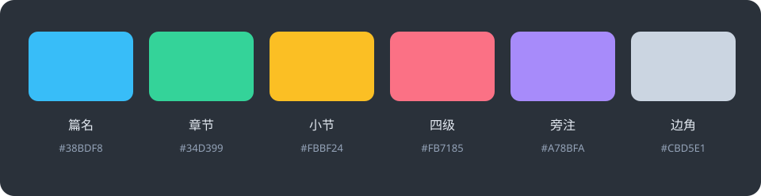
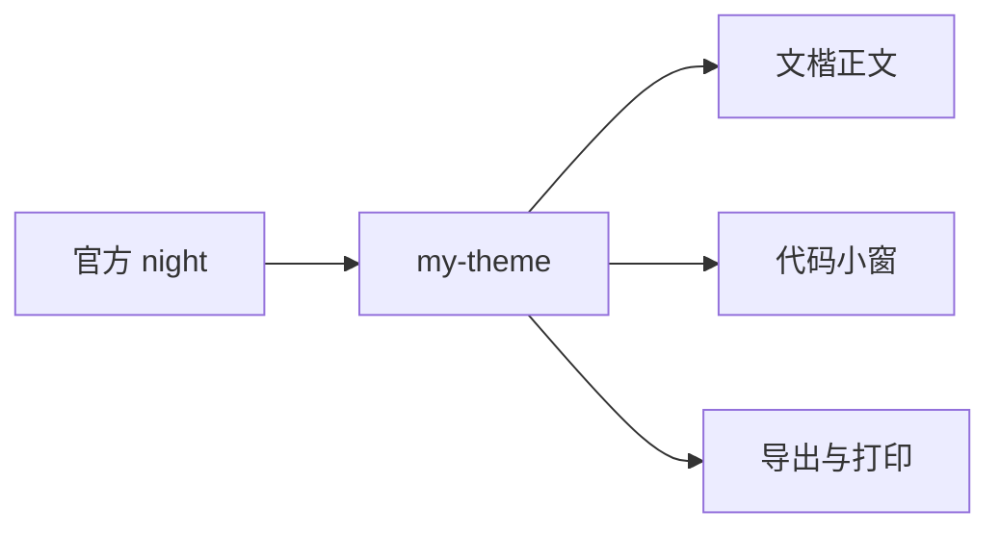
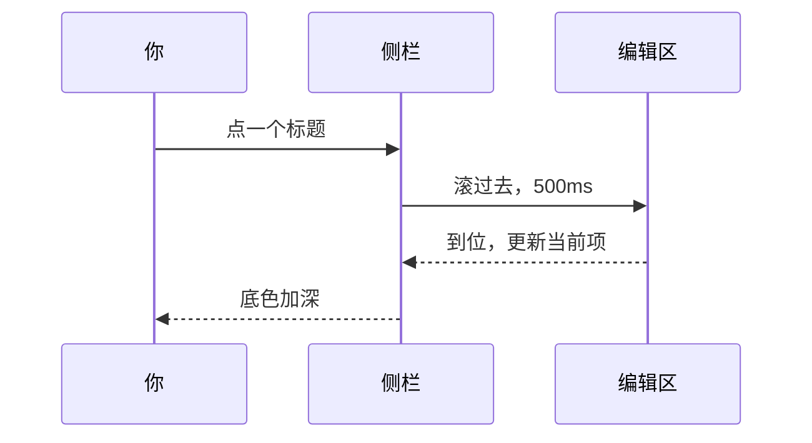

# my-theme：把夜晚留给正文

深夜写字，屏幕不该比句子更亮。**my-theme** 是一套给 [Typora](https://typora.io) 的夜间主题，从官方 *night* 改出来：正文换成霞鹜文楷，六级标题各一种颜色，代码块收进一扇小窗。这篇文章本身就是用它排出来的，你看到的每一种样式，都是主题的一部分。

[TOC]

## 为什么又做一套深色主题

Typora 自带的 night 够用，但它把所有字都提得很亮，读三页眼睛就累。深色主题的难点不在"黑"，而在让该亮的亮、该退的退。my-theme 只做了三件事：

- 正文停在一个偏冷的浅灰上，注释和脚注再退半档
- 亮色只给标题、加粗和链接
- 代码块有自己的底，和正文分成两层

> 一篇文章里真正需要被看见的词不多。把它们找出来，其余的都交给夜色。
>
> > 引用可以再套一层。左边的线从蓝换成绿，底色不变。

常用的强调在一句话里各有位置：**加粗**是暖粉，*斜体*侧过去，***粗斜体***两样都要。过时的说法 ~~划掉~~，想让读者停半秒的用 ==高亮==，必须画线的词用 <u>下划线</u>。分子式写成 H~2~O，平方写成 x^2^，快捷键是 <kbd>⌘</kbd> <kbd>Shift</kbd> <kbd>L</kbd>。行内代码像 `--my-h1: #38BDF8` 这样带一层浅底。<br>
一句话写不下，可以在这里硬换行，仍然是同一段。标点、🌙 表情和外链 <https://github.com/lxgw/LxgwWenKai> 都走正文的颜色，只有链接在字底下带一条细线。

## 它长什么样

### 字：霞鹜文楷

正文、标题、代码共用同一套字。文楷的笔画有手写的松弛，在深底上不发虚。主题随包附带 Light、Regular、Medium 三档字重，不需要在系统里另装字体。

> [!NOTE]
> 文楷没有斜体字库。主题用 `font-synthesis: style` 让渲染引擎把它倾斜，所以 *强调* 和代码里的注释仍然是斜的；粗体用的是真实的 Medium 字重，不会被假粗。

### 色：六级标题

同一种白的标题，夜里会糊成一条。每一级换一种颜色，字号跟着收一号，读到哪一层一眼就知道。侧栏大纲和上面的目录用的是同一组颜色。



| 层级 | 色值 | 还用在哪 |
| :--- | :---: | :--: |
| 一级 | `#38BDF8` | 列表圆点、任务勾、引用左线、NOTE |
| 二级 | `#34D399` | 嵌套引用的左线、diff 的加号行、TIP |
| 三级 | `#FBBF24` | 术语表的词条、WARNING |
| 四级 | `#FB7185` | diff 的减号行、CAUTION |
| 五级 | `#A78BFA` | IMPORTANT |
| 六级 | `#CBD5E1` | 引用、脚注和弱化后的正文 |
| **加粗** | `#FF7BAD` | 需要被看见的词 |
| [链接](https://typora.io) | `#63DCE4` | 字底下的一条细线 |

### 窗：代码块

代码块不铺满整页。上面三枚圆点，中间一道细线，语言名字落在窗的外面，不压住边框。选中文字时只有一层底色，当前行的高亮仍然保留。

```css
:root {
  /* 配色集中在这几行，想换只改这里 */
  --my-font: "LXGW WenKai", "PingFang SC", sans-serif;
  --my-h1: #38BDF8;
  --my-h2: #34D399;
  --my-strong: #FF7BAD;
  --my-code-bg: #303741;
}
```

关键字、字符串、数字、注释各一种颜色，都从标题色里取，不另起一套。

```javascript
function nightPaper(theme = "my-theme") {
  const paper = "#2D333B";
  // 亮的只留给标题
  return theme === "my-theme" ? paper : "#363B40";
}
```

```python
from pathlib import Path

THEMES = Path.home() / "Library/Application Support/abnerworks.Typora/themes"

def install(src: Path) -> None:
    """把 my-theme.css 和 my-theme/ 一起复制过去。"""
    for name in ("my-theme.css", "my-theme"):
        print(f"copy {src / name} -> {THEMES / name}")
```

改动用 diff 看最清楚，加的是绿，删的是粉：

```diff
- font-synthesis: none;
+ font-synthesis: style;
  line-height: 1.75;
```

### 侧栏

大纲和文件树用同一种圆角高亮：悬停是浅浅的一层，当前项是该标题自己颜色的底色。点一下大纲，编辑区滚过去，底色跟着加深。

## 怎么装

### 主题目录

| 系统 | 目录 |
| --- | --- |
| macOS | `~/Library/Application Support/abnerworks.Typora/themes/` |
| Windows | `%APPDATA%\Typora\themes\` |
| Linux | `~/.config/Typora/themes/` |

### 步骤

1. 下载仓库，找到 `my-theme.css` 和 `my-theme` 文件夹
2. 两样一起放进上面的目录
   1. `my-theme/` 里是代码高亮、源码模式、图表三份分段样式
   2. `my-theme/fonts/` 里是三份文楷字重
3. 重新打开 Typora，在 **主题** 菜单里选 my-theme

```bash
cd ~/Downloads/theme
cp my-theme.css "$HOME/Library/Application Support/abnerworks.Typora/themes/"
cp -R my-theme "$HOME/Library/Application Support/abnerworks.Typora/themes/"
```

> [!WARNING]
> `my-theme.css` 用相对路径找旁边的 `my-theme/`。两样分开放，或者改了名字，字体和代码高亮都会丢。

> [!TIP]
> 高亮、上标、下标、行内公式和图表在 Typora 里默认关闭。偏好设置 → Markdown → 语法支持 里勾上，这篇文章里的 ==高亮==、H~2~O、x^2^ 和公式才会渲染。

> [!CAUTION]
> `demo/` 里是官方 night 的原始文件，只用来对照，不要把它一起复制进主题目录。

### 可以改的地方

#### 字体

改 `:root` 里的 `--my-font`。如果新字体也要随主题分发，把 woff2 放进 `my-theme/fonts/`，再改文件顶部对应的 `@font-face`。

#### 颜色

`--my-h1` 到 `--my-h6` 是六级标题色，`--my-strong` 和 `--my-link` 是加粗和链接。改一处，正文、目录、列表圆点、引用左线一起变。

##### 侧栏的颜色

侧栏大纲不单独设色，直接取对应标题的变量，当前项的底色是那个颜色洗淡之后的 16%。

###### 旧内核

洗淡用的是 `color-mix()`。不支持它的旧内核会回退到固定的蓝色底，其它都一样。

## 写作时顺手的几件事

换上主题之后先看三眼：

- [x] 标题是六种颜色，不是同一种白
- [x] 代码在小窗里，语言标签在窗下
- [ ] 用自己的一篇旧文再滚一遍

几个常用的快捷键：

| 操作 | macOS | Windows / Linux |
| --- | --- | --- |
| 切换侧栏 | <kbd>⌘</kbd> <kbd>⇧</kbd> <kbd>L</kbd> | <kbd>Ctrl</kbd> <kbd>Shift</kbd> <kbd>L</kbd> |
| 源码模式 | <kbd>⌘</kbd> <kbd>/</kbd> | <kbd>Ctrl</kbd> <kbd>/</kbd> |
| 专注模式 | <kbd>F8</kbd> | <kbd>F8</kbd> |
| 打字机模式 | <kbd>F9</kbd> | <kbd>F9</kbd> |

<dl>
<dt>角标</dt>
<dd>聚焦三级到六级标题时，左侧有 Typora 自带的级别角标，颜色跟着标题走。</dd>
<dt>专注模式</dt>
<dd>当前段落之外的内容降到四成亮度，颜色不变。</dd>
<dt>导出</dt>
<dd>HTML 和 PDF 用编辑器同一套字体和配色，代码窗的圆点和分隔线都在。</dd>
</dl>

<details>
<summary>字体加载不出来？</summary>
<p>先确认 <code>my-theme/fonts/</code> 里有三个 woff2 文件，再确认 <code>my-theme.css</code> 和 <code>my-theme/</code> 在同一层。两样都对，重启一次 Typora。</p>
</details>

## 公式与图表

行距和字号的关系写进句子里是 $1.75 \times 1.125\,\text{rem}$，单独成行是下面这样：

$$
\text{行高} = 1.75 \times \text{字号} = 1.75 \times 18\,\text{px} = 31.5\,\text{px}
$$

主题从官方 night 长出来，正文、代码和导出各走一条线：



点击大纲时发生的事，用时序图看：



## 导出

> [!IMPORTANT]
> 导出 HTML 时，Typora 会把主题里的字体路径改写成本机的绝对路径。在自己的电脑上打开没有问题；发给别人，文楷会回退到对方系统的中文字体。要把字体带走，导出 PDF。

---

## 最后

一套主题的好坏不在截图里，在你连续写两个小时之后的眼睛里。装上它，打开一篇旧文，往下滚一遍。[^wenkai] [^night]

[^wenkai]: 霞鹜文楷，SIL Open Font License 1.1。字重随主题放在 `my-theme/fonts/`，许可全文在同目录的 `OFL.txt`。
[^night]: Typora 官方 night 主题，保留在仓库的 `demo/`，只作对照。
